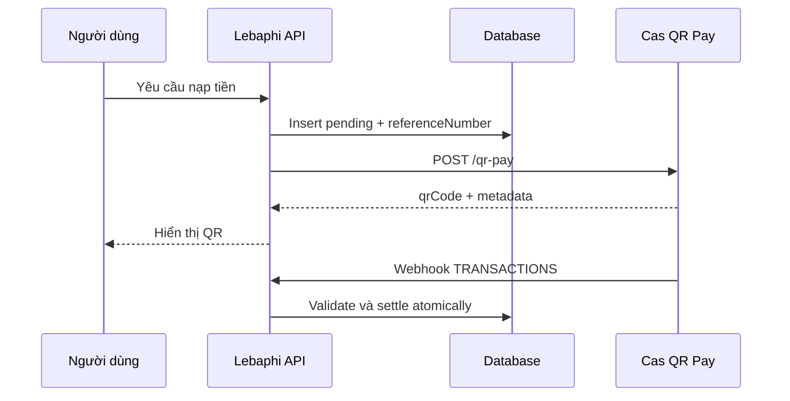

# Thiết kế luồng nạp tiền tự động bằng Cas QR Pay: Case study Lebaphi

**Tác giả:** Lê Bá Phi

**Repository:** https://github.com/phi140307/cas
**Phiên bản:** 1.0, 2026

## Tóm tắt

Bài viết trình bày thiết kế một luồng nạp số dư tự động cho hệ thống dịch vụ số Lebaphi bằng Cas QR Pay. Vấn đề trọng tâm là xác định đúng giao dịch chuyển khoản thuộc về yêu cầu nạp nào, đồng thời bảo đảm một webhook bị gửi lại không thể cộng tiền hai lần. Giải pháp tạo QR động với `referenceNumber` duy nhất cho mỗi yêu cầu nạp, lưu giao dịch ở trạng thái chờ, rồi chỉ cập nhật số dư sau khi nhận webhook giao dịch hợp lệ. Case study sử dụng Next.js ở tầng API và PostgreSQL/Supabase ở tầng settlement. Kết quả thiết kế cho thấy `referenceNumber`, kiểm tra số tiền và khóa hàng database là ba thành phần cốt lõi để đối soát đáng tin cậy.

**Từ khóa:** Open Banking, Cas, QR Pay, tài khoản ảo, webhook, idempotency, đối soát giao dịch.

## 1. Đặt vấn đề

Nạp tiền bằng chuyển khoản ngân hàng thường gặp ba rủi ro. Thứ nhất, nhiều khách có thể chuyển cùng số tiền. Thứ hai, nội dung chuyển khoản có thể bị nhập thiếu hoặc sai. Thứ ba, nhà cung cấp có thể gửi lại webhook khi endpoint phản hồi chậm hoặc gặp lỗi.

Nếu hệ thống cộng số dư chỉ dựa vào số tiền, tên người gửi hoặc trạng thái ở giao diện thì có thể ghi nhận sai người hoặc cộng tiền hai lần. Vì vậy cần một khóa định danh cho từng yêu cầu nạp và một cơ chế settlement nguyên tử ở server.

## 2. Cơ sở kỹ thuật

Cas sử dụng mô hình cấp quyền gồm grant token, Cas Link, public token và access token [1]. Ứng dụng tạo grant với scope phù hợp; người dùng hoàn tất xác thực tại Cas Link; server đổi `publicToken` lấy `accessToken`; sau đó gọi API sản phẩm.

Với QR Pay, request tạo thanh toán bao gồm `amount`, `description` và `referenceNumber` [2]. Response mô tả `qrCode`, `accountNumber`, `virtualAccountNumber` và `referenceNumber`. QR Pay khác Virtual Account cố định: QR Pay phục vụ một lệnh thanh toán cụ thể, còn Virtual Account là số định danh có vòng đời dài hơn.

## 3. Phương pháp nghiên cứu

Bài viết dùng phương pháp case study kỹ thuật:

1. Đọc `cas-sdk` và toàn bộ product skill trong danh mục Cas.
2. Đối chiếu schema API grant, exchange, QR Pay và webhook chính thức.
3. Mô hình hóa luồng nạp tiền của Lebaphi.
4. Xác định bất biến dữ liệu cho settlement.
5. Xây dựng test matrix cho lỗi API, sai số tiền và replay webhook.

Mục tiêu là mô tả thiết kế tái lập được, không công bố credential, dữ liệu tài chính hoặc QR thực tế.

## 4. Thiết kế hệ thống

Luồng Lebaphi gồm sáu bước:

1. Người dùng chọn số tiền nạp trên dashboard.
2. Server tạo `referenceNumber` ngẫu nhiên và insert giao dịch `pending`.
3. Server gọi `POST /qr-pay` của Cas.
4. Client hiển thị `qrCode`; client không được tự cộng tiền.
5. Cas gửi webhook `TRANSACTIONS` sau khi giao dịch được xác nhận.
6. Server kiểm tra webhook và gọi hàm settlement để cập nhật số dư đúng một lần.



`referenceNumber` liên kết ba đối tượng: giao dịch chờ của Lebaphi, request QR Pay và `paymentMeta.referenceNumber` từ webhook. Không dùng username hoặc amount làm khóa này vì chúng có thể trùng.

## 5. Bảo đảm đúng đắn của settlement

Settlement có ba bất biến:

```text
Một referenceNumber chỉ hoàn tất một lần.
Một provider transaction ID không được cộng tiền hai lần.
Số tiền webhook phải bằng số tiền dự kiến của yêu cầu nạp.
```

Trong case study, transaction được lấy với khóa hàng (`FOR UPDATE`). Nếu transaction đã ở trạng thái `completed`, hàm trả `already_completed`. Nếu amount không khớp, hàm trả `amount_mismatch`. Chỉ sau khi kiểm tra thành công, hệ thống mới cập nhật `users.balance`, `total_deposited`, trạng thái transaction và provider transaction ID trong cùng một transaction database.

Đây là cơ chế idempotency ở tầng dữ liệu. Nó an toàn hơn việc chỉ dùng biến nhớ trên web server vì webhook có thể được xử lý bởi nhiều instance khác nhau.

## 6. Bảo mật và môi trường

`clientId`, `secretKey`, `accessToken` và webhook token phải tồn tại ở server-side environment variables. Cas yêu cầu các header `x-client-id`, `x-secret-key`, `X-BankHub-Api-Version` và token phân quyền thô trong `Authorization` [1].

Callback Cas Link cần `state` ngẫu nhiên để chống CSRF. Webhook cần một cơ chế xác thực riêng, xử lý nhanh và idempotent. Sandbox và Production phải tách base URL, credential, access token, webhook và quy trình vận hành [1]. Credential Sandbox không thể gọi endpoint Production.

## 7. Đánh giá và giới hạn

Thiết kế được đánh giá bằng các kịch bản: tạo QR thành công, thiếu secret, API QR lỗi, webhook amount đúng, webhook amount sai và replay webhook. Mỗi kịch bản có thể tái hiện bằng fixture redaction trong repository.

Một giới hạn quan trọng là đặc điểm `virtualAccountNumber` phụ thuộc vào dịch vụ tài chính được liên kết. Ứng dụng cần hiển thị tách bạch `virtualAccountNumber` và `accountNumber` từ response Cas, thay vì giả định chúng luôn khác nhau. Production chỉ được công bố là hoàn tất khi có bằng chứng webhook, settlement migration và checklist launch tương ứng.

## 8. Kết luận

Cas QR Pay giúp hệ thống gắn mỗi yêu cầu nạp với một payment reference rõ ràng. Tuy nhiên QR tạo thành công không phải là bằng chứng đã thanh toán. Độ tin cậy của hệ thống đến từ webhook được xác thực, so sánh chính xác số tiền, database transaction và idempotency khi retry.

Lebaphi minh họa một cách tiếp cận có thể mở rộng: UI chỉ khởi tạo yêu cầu; server quản lý QR và secrets; database quyết định settlement; webhook là nguồn sự thật cho thay đổi số dư.

## Tài liệu tham khảo

[1] Cas, "Cas SDK - Core", https://cas.so/skills/cas-sdk/SKILL.md

[2] Cas, "Tạo mã thanh toán QR Pay", https://cas.so/general/api/product-qr-pay/create-qr-pay.md

[3] Cas, "Webhook", https://cas.so/general/api/webhook.md

[4] Cas, "Cas Link", https://cas.so/general/link.md
[5] Cas, "Launch checklist", https://cas.so/launch-checklist.md

Tài liệu mở rộng, code mẫu và sơ đồ: [README](README.md).
