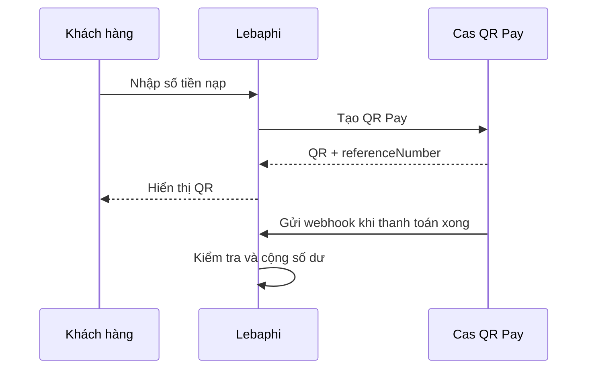

# Báo cáo nhỏ: Tìm hiểu Cas QR Pay trong website Lebaphi

**Người thực hiện:** Lê Bá Phi
**Repository:** https://github.com/phi140307/cas

## 1. Lý do tìm hiểu

Lebaphi là website bán dịch vụ số. Người dùng cần nạp tiền để sử dụng dịch vụ, vì vậy website cần biết chính xác ai đã chuyển tiền và số tiền đó thuộc về yêu cầu nạp nào.

Nếu chỉ dùng một số tài khoản ngân hàng cố định thì khá khó đối soát. Có thể có nhiều người chuyển cùng số tiền, hoặc khách ghi sai nội dung. Cas QR Pay hỗ trợ tạo QR riêng cho từng yêu cầu nạp nên phù hợp với bài toán này.

## 2. Cas QR Pay hoạt động như thế nào?

Trước tiên, chủ website liên kết tài khoản ngân hàng với Cas. Sau khi liên kết thành công, server nhận được access token để gọi API tạo QR.

Khi một khách nạp tiền, Lebaphi gửi ba thông tin chính cho Cas:

```json
{
  "amount": 100000,
  "description": "LEBAPHI",
  "referenceNumber": "cas_deposit_<uuid>"
}
```

Cas trả về mã QR để khách quét. Theo tài liệu QR Pay, response còn có `accountNumber`, `virtualAccountNumber` và `referenceNumber`. `referenceNumber` là mã riêng của từng yêu cầu nạp và là phần quan trọng nhất trong hệ thống.



## 3. Tài khoản ảo theo từng đơn

Trong QR Pay, Cas có thể tạo tài khoản ảo gắn với từng đơn thanh toán. Điều này khác với Virtual Account cố định.

- QR Pay dùng cho một lần thanh toán cụ thể, scope là `qrpay`.
- Virtual Account cố định dùng để quản lý khoản phải thu lâu dài, scope là `virtual_account`.

Tuy nhiên cách hiển thị số tài khoản phụ thuộc vào dịch vụ ngân hàng đã liên kết. Vì vậy website cần đọc và hiển thị riêng hai trường `virtualAccountNumber` và `accountNumber`, không tự đoán hai số này luôn khác nhau.

## 4. Cách Lebaphi xử lý nạp tiền

Khi khách bấm tạo QR, server tạo một giao dịch nạp ở trạng thái `pending`. Sau đó server gọi Cas để tạo QR.

Việc cộng tiền chưa xảy ra ở bước này. Lebaphi chỉ cộng số dư khi Cas gửi webhook `TRANSACTIONS` báo giao dịch thành công. Webhook chứa `paymentMeta.referenceNumber`, từ đó hệ thống tìm đúng yêu cầu nạp trước đó.

Các file chính trong demo:

| File | Công việc |
| --- | --- |
| `lib/cas-qr-pay.ts` | Gọi API Cas và giữ credential ở server |
| `app/api/cas/deposit/route.ts` | Tạo yêu cầu nạp và QR |
| `app/api/webhook/cas/route.ts` | Nhận webhook từ Cas |
| `complete_cas_deposit` | Cộng số dư trong database |

## 5. Vì sao cần chống cộng tiền hai lần?

Webhook có thể được gửi lại nếu server lỗi hoặc phản hồi chậm. Nếu không kiểm tra, cùng một giao dịch có thể cộng tiền nhiều lần.

Lebaphi xử lý bằng cách:

1. Tìm giao dịch theo `referenceNumber`.
2. Khóa giao dịch trong database.
3. Kiểm tra số tiền webhook có đúng số tiền khách chọn hay không.
4. Nếu giao dịch đã `completed` thì không cộng lại.
5. Lưu mã giao dịch của Cas sau khi cộng tiền thành công.

## 6. Lưu ý bảo mật

- Không đưa `CAS_SECRET_KEY`, access token hoặc webhook token lên client.
- Không commit file `.env` lên GitHub.
- Sandbox và Production dùng key, token và URL khác nhau.
- Không dùng QR Sandbox để nhận tiền thật.
- Webhook phải được kiểm tra trước khi cập nhật số dư.

## 7. Kết luận

Cas QR Pay giúp Lebaphi tạo QR riêng cho từng lần nạp. Cách này dễ đối soát hơn việc chỉ dùng một số tài khoản cố định. Phần quan trọng nhất không phải giao diện QR, mà là `referenceNumber`, webhook và cơ chế chỉ cộng số dư một lần.

Code ví dụ đơn giản nằm trong thư mục [examples](examples/). Tài liệu chi tiết hơn nằm trong thư mục [docs](docs/).

## Nguồn tham khảo

- [Cas Skills](https://cas.so/skills)
- [Tạo QR Pay](https://cas.so/general/api/product-qr-pay/create-qr-pay.md)
- [Webhook Cas](https://cas.so/general/api/webhook.md)
- [Cas Link](https://cas.so/general/link.md)
