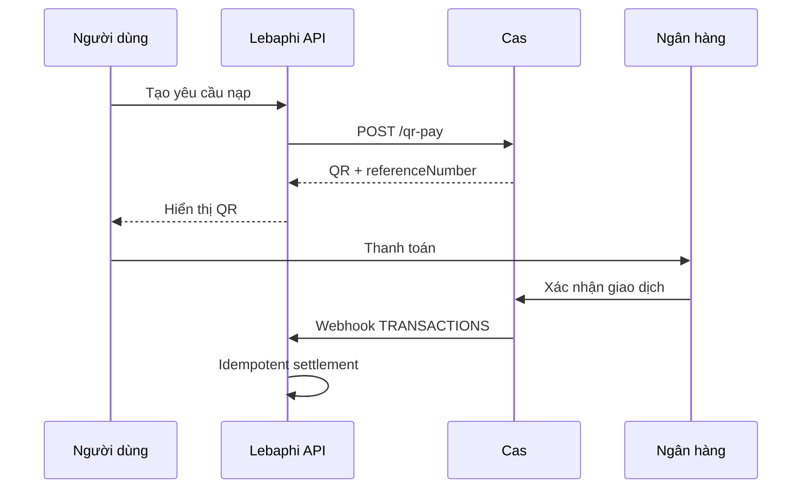

# Nền tảng lý thuyết

## Open Banking theo quyền cấp

Thay vì ứng dụng giữ mật khẩu ngân hàng của khách, Cas dùng quyền cấp (grant). Ứng dụng tạo yêu cầu quyền, Cas Link thực hiện xác thực và chỉ trả `publicToken`; server đổi token này lấy `accessToken` để gọi API sản phẩm.

Mô hình này tách ba vai trò:

| Vai trò | Trách nhiệm |
| --- | --- |
| Ứng dụng | Khởi tạo grant, bảo vệ secret, xử lý nghiệp vụ |
| Cas Link | Xác thực người dùng và cấp quyền |
| Dịch vụ tài chính | Giữ tài khoản và thực hiện thanh toán |

## QR tĩnh, QR động và tài khoản ảo

QR tĩnh thường chỉ định người nhận. Merchant phải suy luận giao dịch thuộc đơn nào từ nội dung hoặc số tiền.

QR động có dữ liệu của một lệnh: số tiền, mô tả và mã tham chiếu. Với QR Pay, Cas mô tả mỗi QR có thể sinh VA gắn với đơn; `referenceNumber` là khóa liên kết giữa hệ thống merchant, lệnh QR và webhook.

## Event-driven settlement

Giao diện chỉ khởi tạo yêu cầu nạp. Quyết định cộng số dư đến từ webhook giao dịch. Đây là mẫu event-driven:

## Idempotency

Webhook có thể retry hoặc tới lặp. Hàm settlement phải biến một event provider thành tối đa một thay đổi số dư. Một thiết kế tối thiểu cần:

1. Khóa giao dịch nội bộ theo `referenceNumber`.
2. Kiểm tra trạng thái hiện tại.
3. Kiểm tra `paid_amount` bằng số tiền kỳ vọng.
4. Lưu provider transaction ID.
5. Chỉ cập nhật số dư khi giao dịch chưa hoàn tất.
