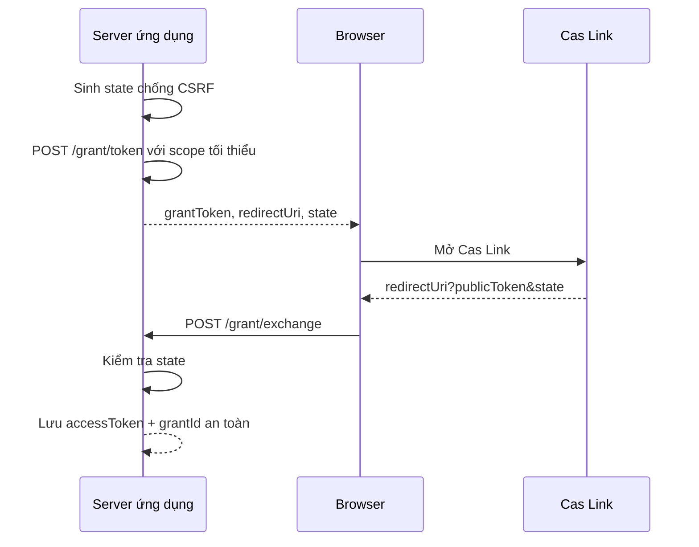

# Grant, Cas Link và Access Token

## Luồng chuẩn

## Môi trường và header

| Thành phần | Sandbox | Production |
| --- | --- | --- |
| API base URL | `https://sandbox.bankhub.dev` | `https://production.bankhub.dev` |
| Cas Link | `https://dev.link.bankhub.dev` | `https://link.bankhub.dev` |

Mọi request server-side cần `x-client-id`, `x-secret-key`, `X-BankHub-Api-Version: 2023-01-01`. API cần quyền thêm `Authorization: <accessToken>` dưới dạng token trần.

## Điều cần lưu

- Không gửi `secretKey` hay `accessToken` vào client.
- State callback phải được so sánh an toàn và có thời hạn ngắn.
- Một access token Sandbox không dùng cho Production và ngược lại.
- Khi nhận `GRANT_LOGIN_REQUIRED`, mở Cas Link Update Mode thay vì bắt đầu lại không kiểm soát.
