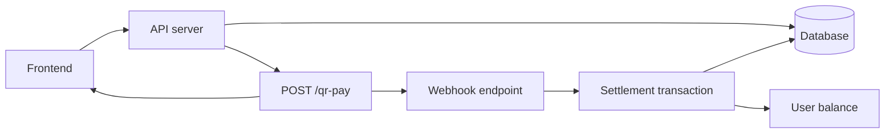

# Mô hình triển khai QR Pay

## Kiến trúc

## Thành phần chính

| Trách nhiệm | Thành phần tổng quát |
| --- | --- |
| Config, headers, timeout | Module Cas server-side |
| Tạo pending deposit và QR | Deposit API |
| Hiển thị QR/VA response | Frontend payment view |
| Kiểm tra trạng thái giao dịch | Deposit status API |
| Nhận webhook | Webhook handler |
| Settlement | Database transaction |

## Quy trình deposit

1. User nhập amount hợp lệ.
2. Server xác thực user và ghi transaction `pending` cùng `referenceNumber` ngẫu nhiên.
3. Server gọi Cas QR Pay với amount và reference number.
4. Client chỉ hiển thị QR; chưa thay đổi số dư.
5. Cas gửi webhook giao dịch.
6. RPC khóa transaction, xác minh amount, cập nhật ví và đánh dấu completed.

## Quan sát nghiên cứu

Một QR được tạo thành công không phải bằng chứng tiền đã vào. Webhook hợp lệ, idempotent settlement và database commit mới là bằng chứng thay đổi số dư.
