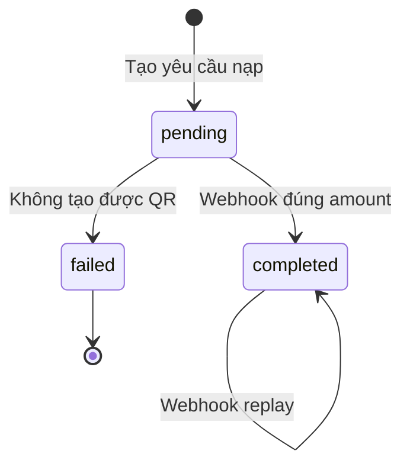

# Webhook, đối soát và idempotency

## Webhook QR Pay

Lebaphi chỉ xử lý event có:

- `webhookType = TRANSACTIONS`.
- `transaction.paymentMeta.referenceNumber` khớp deposit đang chờ.
- `transaction.id` hoặc `transactionCode` để định danh giao dịch provider.
- Amount dương và bằng `metadata.base_amount`.

## State machine



## Pseudocode

```text
lock deposit by referenceNumber
if not found: return not_found
if completed: return already_completed
if expected amount != webhook amount: return amount_mismatch
lock user
credit balance and total_deposited
store provider transaction id
mark completed
```

`FOR UPDATE` làm cho hai webhook đồng thời không thể cùng đọc trạng thái pending rồi cộng số dư hai lần.

## Retry

Cas có thể retry webhook khi endpoint lỗi hoặc chậm. Vì vậy endpoint nên xác thực nhanh, phản hồi 2xx sau khi settlement thành công/đã hoàn tất và không thực hiện side effect lặp.
